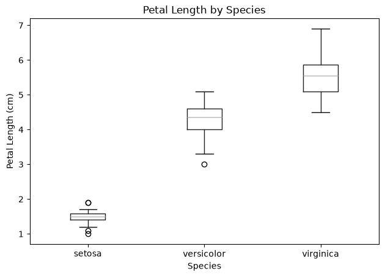

# YU YISHAN — Data Science Portfolio

## About Me
I am a student at the University of Macau (Student ID: MC656619). This portfolio showcases my data analysis work, including data exploration, visualization, and interpretation of results. 

## Technical Skills
- **Languages:** Python
- **Data Analysis:** pandas, scikit-learn
- **Visualization:** matplotlib
- **Tools:** Jupyter Notebook, GitHub

## Project Showcase

### Iris Petal Measurements: An Exploratory Analysis
**Research Question:** Which flower measurements best distinguish the three Iris species (setosa, versicolor, virginica), and how do the species differ?

**Visualization:**

**Findings:** Petal length is the most discriminative feature. Setosa has clearly shorter petals, while versicolor and virginica are separable but slightly overlap.

**Project Repository:** [data-science-project](https://github.com/mc65661/data-science-project)

**Status:** Completed
